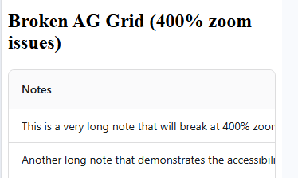

# Aggrid400Demo

This project was generated using [Angular CLI](https://github.com/angular/angular-cli) version 22.0.4.

## Development server

To start a local development server, run:

```bash
ng serve
```

Once the server is running, open your browser and navigate to `http://localhost:4200/`. The application will automatically reload whenever you modify any of the source files.

## Code scaffolding

Angular CLI includes powerful code scaffolding tools. To generate a new component, run:

```bash
ng generate component component-name
```

For a complete list of available schematics (such as `components`, `directives`, or `pipes`), run:

```bash
ng generate --help
```

## Building

To build the project run:

```bash
ng build
```

This will compile your project and store the build artifacts in the `dist/` directory. By default, the production build optimizes your application for performance and speed.

## Running unit tests

To execute unit tests with the [Vitest](https://vitest.dev/) test runner, use the following command:

```bash
ng test
```

## Running end-to-end tests

For end-to-end (e2e) testing, run:

```bash
ng e2e
```

Angular CLI does not come with an end-to-end testing framework by default. You can choose one that suits your needs.

## Additional Resources

For more information on using the Angular CLI, including detailed command references, visit the [Angular CLI Overview and Command Reference](https://angular.dev/tools/cli) page.

# ZOOM 400 Review

## 1) Summary

- AG Grid is exempt from certain WCAG 2.2 Reflow requirements because complex data grids cannot reasonably reflow at 400% zoom without losing functionality.

- However, exemption ≠ no responsibility — mitigations must still be applied to ensure usability for low‑vision and keyboard users.

- This presentation shows:

  - The problem (broken grid at 400% zoom)

  - The exemption

  - The mitigation options

  - Their pros and cons

  - A recommended approach

  <hr/>

  ## 2) The Problem

  “What happens at 400% zoom?”

  - Columns overflow off-screen

  - Keyboard focus moves into invisible cells

  - Text clips or ellipses hide information

  - Horizontal scrolling becomes mandatory

  - WCAG 1.4.10 Reflow fails

  - WCAG 2.4.7 Focus Visible fails

  - Grid becomes unusable for low‑vision users

  

  ## 3) WCAG Grid Exemption

  **Why grids are exempt from 1.4.10 Reflow**

  WCAG allows an exemption for **complex data grids** because:

  - Reflowing a grid destroys the tabular relationships

  - Columns cannot collapse without losing meaning

  - Horizontal scrolling is permitted for data tables

  - Keyboard navigation patterns must remain intact

  - Screen readers rely on row/column semantics

  **Key point:**

  **Exemption applies only to the layout — not to usability.**  
  You still must mitigate focus, visibility, and operability issues.

## 4) What Must Still Be Accessible

Even with the exemption, the grid must still satisfy:

- 2.1.1 Keyboard — full keyboard operability

- 2.4.3 Focus Order — logical focus movement

- 2.4.7 Focus Visible — visible focus indicator

- 1.4.12 Text Spacing — readable text

- 4.1.2 Name, Role, Value — correct ARIA semantics

This is where mitigations come in.

## 5) Mitigation Options (5 - 10)

**Text Wrapping Instead of Ellipses**

```css
.ag-cell {
  white-space: normal !important;
  overflow-wrap: break-word !important;
  text-overflow: clip !important;
}
```

**What it does**

- Removes ellipses

- Shows full text at 320px width

- Prevents information loss

**Pros**

- Fully WCAG-compliant

- No hidden content

- Works at any zoom level

- No extra UI required

**Cons**

- Rows become taller

- Dense data becomes harder to scan

- Layout may look less “enterprise”

## 6) Keyboard Auto‑Scroll

```TS
event.api.ensureIndexVisible(event.rowIndex);
event.api.ensureColumnVisible(event.column);
```

**What it does**

- Ensures focused cell is always visible

- Prevents “invisible focus” failures

- Uses ensureIndexVisible + ensureColumnVisible

**Pros**

- Fixes the biggest accessibility failure

- Works with arrow keys, tab, home/end

- No visual changes

**Cons**
- Requires custom event handling

- Slight scroll movement may surprise users

**Best for:**  
- Keyboard users, screen reader users

## 7) Strong Focus Indicator

```CSS
.ag-cell:focus {
  outline: 3px solid #005fcc;
  outline-offset: -2px;
}
```

**What it does**

- Adds a high‑contrast outline

- Makes keyboard focus obvious

**Pros**

- Required for WCAG 2.4.7

- Helps low‑vision users

- Easy to implement

**Cons**

- Must meet 3:1 contrast

- Can clash with design system if not styled carefully

**Best for:**

- All users

## 8) Tooltip or “Reveal Full Text” on Focus

No CSS required - tooltip is configured via AG Grid:

```TS
tooltipField: 'notes'
```
Optional CSS for tooltip visibility

```CSS
.ag-tooltip {
  font-size: 1rem;
  line-height: 1.4;
}
```

**What it does**

- Shows full text when cell is focused

- Allows ellipses to remain visually

**Pros**

- Preserves compact layout

- Full text always available

- Works well for long notes/comments

**Cons**

- Adds interaction complexity

- Requires keyboard-accessible tooltip

- Must avoid hover-only behaviour

**Best for:**

- Dense grids where wrapping is undesirable

## 9) Detail Panel / Row Expansion

```CSS
.ag-details-row {
  white-space: normal;
  padding: 12px;
}
```

**What it does**

- Clicking or focusing a row reveals full details

- Ideal for long text fields

**Pros**

- Very user-friendly

- Works well for mobile and zoomed layouts

- Reduces clutter

**Cons**

- Adds UI complexity

- Requires additional ARIA roles

- Not ideal for dense tabular data

**Best for:**

- Complex rows with multiple long fields

## 10) Comparison Table

| Mitigation | WCAG Benefit | Pros | Cons | Best For |
| --- | --- | --- | --- | --- |
| Text Wrapping | Reflow, Text Spacing | Simple, full visibility | Taller rows | Long text fields |
| Auto‑Scroll | Focus Visible | Prevents invisible focus | Slight movement | Keyboard users |
| Strong Focus | Focus Visible | Clear focus | Styling required | All users |
| Tooltip Reveal | Info & Relationships | Compact layout | Must be accessible | Notes/comments |
| Detail Panel | Info & Relationships | Very readable | More UI | Complex rows |


